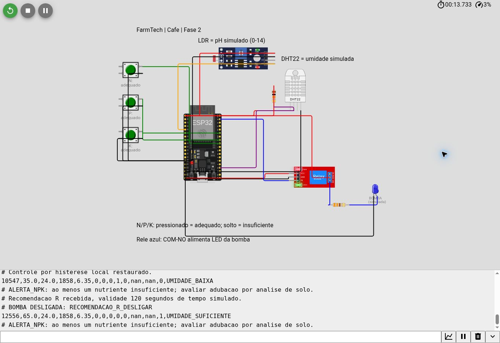
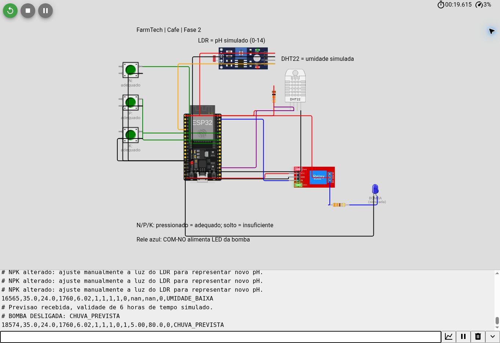

# FarmTech Solutions · Fase 2

## Irrigação e monitoramento de um talhão de café

**Aluno:** Marlon Gomes Rodrigues — RM576052  
**Modalidade:** trabalho individual.  
**Curso/turma:** preencher conforme o portal.  
**Etapa:** Fase 2 — sensores e irrigação inteligente.  
**Vídeo no YouTube, não listado:** https://youtu.be/yCt7obJDfs8
**Projeto salvo no Wokwi:** https://wokwi.com/projects/477560157109657601

O protótipo acompanha um talhão de café, uma das culturas usadas na Fase 1, e comanda uma bomba representada por um relé azul. A umidade simulada define a necessidade de água. Três botões representam a suficiência de N, P e K; o LDR representa o pH. A previsão meteorológica em Python e a análise de uma sequência de leituras em R complementam o controle local.

Esta versão é uma base para estudo, teste e revisão individual. Antes da entrega, o aluno deve compreender o código, conferir as escolhas e adaptar a explicação à experiência obtida ao executar o circuito. O pacote não inclui publicação em GitHub nem um vídeo gravado.

## 1. Contexto agrícola e limites do modelo

O cenário escolhido é café arábica em solo, com irrigação localizada. A Fase 1 calculava áreas e insumos para café e cana-de-açúcar. Nesta fase, um único ESP32 representa **um talhão de café**; a área pode futuramente apoiar o dimensionamento da vazão e do volume aplicado. Não há integração automática com os arquivos da Fase 1 nem cálculo de litros neste protótipo, pois não foi informado um valor real de vazão.

### Pesquisa sobre necessidades da cultura

O artigo de Silva, Lima e Oliveira (2010), publicado em *Idesia*, apresenta 5,5–6,5 como faixa de pH favorável ao café. Esta é a referência para o alerta de pH simulado [1].

A recomendação técnica da Embrapa Cerrados para café [2] condiciona a fertilização ao solo, à textura e à fase da cultura. Como exemplos restritos ao contexto do documento:

| Nutriente | Exemplo de necessidade documentada | Representação no protótipo |
|---|---|---|
| N | Após o pegamento das mudas, o documento indica 5 g de N por planta, repetidos até três vezes no período chuvoso | Botão N indica suficiência/insuficiência, sem estimar uma dose |
| P | Em solo com 160–350 g/dm³ de argila, P por Mehlich-1 acima de 15 mg/dm³ é classificado como adequado | Botão P representa o resultado qualitativo de uma avaliação |
| K | Na classe com CTC a pH 7 maior que 4 cmolc/dm³ ou argila maior que 200 g/dm³, K acima de 90 mg/dm³ é classificado como adequado | Botão K representa o resultado qualitativo de uma avaliação |

Esses exemplos não são prescrições para qualquer lavoura. Não se pode obter concentração em mg/dm³ ou dose em kg/ha a partir de um botão. Para uso real, seria preciso medir o solo, considerar a espécie, o estádio, a produtividade esperada e revisar o manejo com acompanhamento agronômico.

### Substituições didáticas exigidas

- O **DHT22 mede umidade relativa do ar**, e não água no solo. Neste trabalho, seu percentual é tratado como um **índice didático de umidade do solo**. Os valores 25%, 40% e 60% não são recomendações agronômicas para o café.
- O **LDR mede luz**, e não pH. A conversão `pH_simulado = ADC × 14 / 4095` é uma escala de simulação, sem calibração química. O ADC foi configurado em 12 bits [3].
- Os botões indicam tudo ou nada: pressionado significa nutriente considerado adequado; solto significa insuficiente. Não há detecção de excesso de nutrientes.
- NPK e pH geram alertas independentes. **A falta de nutrientes não desliga a água nem é corrigida pela irrigação comum.** Essa decisão de projeto evita confundir adubação com fornecimento de água.
- Ao alterar qualquer botão, o operador deve **alterar manualmente a intensidade do LDR** para representar uma mudança de pH, conforme o enunciado. O código lembra essa ação; não inventa uma relação química fixa entre NPK e pH.
- Umidade instantânea não é uma medição do quanto choveu. O opcional meteorológico usa previsão externa, com unidade em milímetros.

## 2. Circuito no Wokwi

O arquivo `esp32/diagram.json` contém o circuito reproduzível. As imagens abaixo são capturas do simulador, não ilustrações geradas.






### Componentes

1 ESP32 DevKitC V4; 3 botões verdes; 1 módulo LDR; 1 DHT22; 1 relé com cubo azul; 1 LED azul para representar visualmente a bomba; 1 resistor de 330 Ω para o LED e 1 resistor de 10 kΩ para pull-up da linha do DHT22.

### Ligações

| Componente | Pino do componente | ESP32/destino | Função |
|---|---|---|---|
| Botão N | `1.r` | GPIO18 | Entrada N, `INPUT_PULLUP` |
| Botão P | `1.r` | GPIO19 | Entrada P, `INPUT_PULLUP` |
| Botão K | `1.r` | GPIO21 | Entrada K, `INPUT_PULLUP` |
| Três botões | `2.r` | GND | Fecha o contato ao pressionar |
| LDR | VCC / GND | 3V3 / GND | Alimentação |
| LDR | AO | GPIO34, ADC1 | Leitura analógica; DO sem ligação |
| DHT22 | VCC / GND | 3V3 / GND | Alimentação |
| DHT22 | SDA | GPIO15 | Dados; resistor de 10 kΩ entre SDA e 3V3 |
| Relé | VCC / GND | 5V / GND | Alimentação do módulo |
| Relé | IN | GPIO23 | Controle da bobina |
| Relé | COM | 3V3 | Alimentação da carga simulada |
| Relé | NO | Resistor 330 Ω → ânodo do LED | LED só recebe energia quando COM-NO fecha |
| LED | Cátodo | GND | Retorno da carga |
| Relé e DHT22 | NC | Sem ligação | Contatos não utilizados |

Os contatos `1.l/1.r` de um botão pertencem ao mesmo lado e permanecem unidos. A ligação utiliza `1.r` e `2.r`, lados distintos, para que só haja continuidade ao pressionar [4]. A entrada lê LOW ao pressionar; o programa transforma isso em `true` após 40 ms de estabilidade.

O relé foi configurado com `transistor: "pnp"`, **ativo em LOW**. O código usa LOW para ligar e HIGH para desligar. Essa polaridade deve ser mantida junto com o atributo do diagrama. A seção Attributes da documentação classifica `pnp` como active-low [5]; o acionamento deve ser conferido pelo LED nos contatos, porque há descrição divergente na seção Operation da mesma página.

O LED azul é a carga demonstrativa, não um LED conectado diretamente ao GPIO de controle. Assim, a evidência visual verifica o estado dos contatos COM-NO. Uma bomba real exigiria alimentação e acionamento compatíveis; não seria alimentada pelo pino 3V3 do ESP32.

## 3. Lógica de controle

### Ordem de prioridade

| Prioridade | Condição | Decisão |
|---|---|---|
| 1 | Bomba permaneceu ligada continuamente por 120 s de tempo simulado | Desliga e bloqueia até `REARME` |
| 2 | DHT22 não retornou uma leitura válida, ou valor fora de 0–100 | Desliga |
| 3 | Umidade ≥ 60 | Desliga por umidade suficiente |
| 4 | Umidade ≤ 25 | Liga por condição crítica, mesmo com previsão de chuva ou recomendação R para desligar |
| 5 | Previsão válida: chuva acumulada ≥ 3 mm **e** maior probabilidade horária ≥ 60% | Suspende irrigação |
| 6 | Recomendação R válida, `R LIGAR` ou `R DESLIGAR` | Segue o comando, respeitando as prioridades anteriores |
| 7 | Sem recomendação R e umidade < 40 | Liga |
| 8 | Sem recomendação R e 40 ≤ umidade < 60 | Mantém o estado anterior |

**Histerese:** usando só o controle local, 35 liga, 50 mantém ligada, 60 desliga e 50 mantém desligada. É necessário cair abaixo de 40 para iniciar novamente. Na partida, a bomba fica desligada até uma leitura válida; com umidade inicial 50, permanece desligada.

Os limiares são constantes didáticas escolhidas para facilitar a demonstração. O limite de 120 s evita irrigação indefinida caso o operador não mude o DHT22. O Wokwi não faz a umidade subir porque a bomba ligou: o operador altera o sensor. O comando `REARME` remove o bloqueio e a lógica reavalia as condições; não força a bomba a ligar.

O programa lê o DHT22 a cada 2 s, calcula a média de 16 amostras do ADC e verifica botões e comandos em ciclos curtos. A biblioteca usada para o DHT22 é `DHT sensor library for ESPx`, recomendada pelo Wokwi para ESP32 [6].

### O papel de NPK e pH

Cada linha de dados registra `n`, `p` e `k` como 0 ou 1 e o pH simulado. O programa emite `ALERTA_NPK` se algum nutriente for insuficiente e `ALERTA_PH` se o pH estiver abaixo de 5,5 ou acima de 6,5. Essas condições ajudam o operador a avaliar o solo, sem substituir um laudo nem uma aplicação de fertilizantes. A lógica de irrigação é deliberadamente guiada pela água e pelo clima; a Fase 2 permite definir e documentar a combinação de critérios adotada.

## 4. Executar no Wokwi

1. Abra [um projeto ESP32 novo](https://wokwi.com/projects/new/esp32).
2. Substitua todo o conteúdo de `sketch.ino` pelo arquivo `esp32/sketch.ino` deste pacote.
3. Substitua todo o conteúdo de `diagram.json` pelo arquivo `esp32/diagram.json`.
4. Em **Library Manager**, adicione **DHT sensor library for ESPx**. Alternativamente, crie `libraries.txt` com o conteúdo de `esp32/libraries.txt`.
5. Inicie a simulação. Espere pelo menos 2 s de **tempo simulado**, que podem demorar mais em um computador ou ambiente lento.
6. Clique no DHT22 e altere **Humidity** para testar 35, 50 e 65. Não é necessário mudar a temperatura.
7. Pressione os botões verdes. As teclas N, P e K funcionam quando o diagrama tem foco. Para manter um botão pressionado com o mouse, use Ctrl+clique, conforme a documentação do Wokwi; o próximo clique libera [4]. Não foi implementada alternância em software: o valor representa o estado físico pressionado/solto.
8. Clique no LDR e ajuste a luz. Confira o pH na coluna `ph` do Monitor Serial. A escala depende da tensão analógica, não de uma tabela universal de lux. Busque um valor próximo de 6,0 para a demonstração.
9. Digite os comandos abaixo no campo do Monitor Serial e pressione Enter. Use ponto como separador decimal.
10. Salve o projeto na sua conta e acrescente o link no início deste README.

### Comandos

| Comando | Efeito |
|---|---|
| `CHUVA 5 80` | Informa 5 mm na janela meteorológica e maior probabilidade horária de 80% |
| `CHUVA 0 0` | Informa uma previsão recebida sem chuva na janela |
| `CLIMA OFF` | Remove a previsão e usa controle local; não significa tempo seco |
| `R LIGAR` | Recebe recomendação estatística para irrigar, respeitando os bloqueios |
| `R DESLIGAR` | Recebe recomendação estatística para desligar, exceto umidade crítica |
| `R AUTO` | Remove a recomendação R e restaura a histerese local |
| `REARME` | Remove bloqueio por tempo máximo contínuo |
| `STATUS` | Imprime uma linha com os últimos sensores e estado |
| `AJUDA` | Exibe comandos e cabeçalho CSV |

Comandos inválidos, probabilidades fora de 0–100, chuva negativa, `nan`, infinitos ou texto adicional são rejeitados. Uma linha grande demais é descartada inteira. A previsão vence após 6 h de tempo simulado desde o recebimento; a recomendação R vence após 120 s. Após o vencimento, o sistema volta ao controle local. Reiniciar o ESP32 descarta esses dados. A previsão ausente aparece no CSV como `clima_valido=0` e chuva/probabilidade `nan`, sem apresentar dado desconhecido como zero.

## 5. Ir Além 1 — Python e API meteorológica

O programa utiliza a [Open-Meteo Forecast API](https://open-meteo.com/en/docs), uma API pública apropriada para a demonstração acadêmica. Não requer chave nesta modalidade [7]. Requer Python 3.10 ou superior; não exige instalação de bibliotecas adicionais.

Execute a partir da raiz do projeto:

```bash
python python/clima.py
```

No Windows, se necessário, substitua `python` por `py`. O ponto padrão é uma coordenada municipal aproximada de **Varginha/MG**, escolhida para demonstração em região cafeeira; não é a localização real de uma fazenda do aluno. Para usar o local do estudo:

```bash
python python/clima.py --latitude -21.55 --longitude -45.43
```

O programa obtém precipitação horária e probabilidade horária, seleciona seis períodos horários futuros, soma os milímetros e usa a maior probabilidade horária como indicador. Cada período termina na hora indicada pela API. Como a consulta pode ocorrer entre horas inteiras, os seis períodos sobrepõem parte da hora corrente e não correspondem a uma janela contínua exata de seis horas a partir do segundo da consulta.

**A maior probabilidade horária não é a probabilidade conjunta de chover nas seis horas.** O indicador foi adotado como regra didática de suspensão: total ≥ 3 mm e máximo horário ≥ 60%. A janela e os limiares não estimam a lâmina de irrigação nem garantem chuva no talhão.

São produzidos `resultados/clima/resposta_api.json`, `resumo.json` e `comando_serial.txt`. Copie o comando gerado, por exemplo `CHUVA 5.00 80.0`, para o Monitor Serial enquanto o ESP32 estiver executando. Essa transferência **é manual**, uma das opções aceitas pelo enunciado. O Python não acessa automaticamente o simulador pela porta USB do computador.

Se a consulta falhar ou a resposta estiver incompleta, o script termina com erro, sem emitir um novo comando. Não reutilize arquivos antigos de saída como se fossem uma previsão atual. O timestamp de consulta e as horas usadas ficam registrados em `resumo.json`. Cole o resultado imediatamente e execute nova consulta para atualizar. O prazo no ESP32 conta tempo simulado desde a transferência e não verifica a idade real dos dados copiados.

`docs/evidencias/` contém a consulta feita durante a preparação do projeto, com data e coordenadas registradas. Esse arquivo é uma **evidência histórica**, não a previsão a usar na data da apresentação. Atribuição dos dados: Open-Meteo.

## 6. Ir Além 2 — análise estatística em R

O script `r/analise_irrigacao.R` usa apenas funções do R base. Ele apresenta média, mediana, desvio-padrão, mínimo e máximo da umidade, ocorrências de pH na faixa e ocorrências de insuficiência de cada nutriente.

Para apoiar a decisão, examina as últimas cinco leituras consecutivas, com intervalos de até 5 s, calcula a média e ajusta `lm(umidade ~ segundos)`. Extrapola somente o próximo intervalo de amostragem, limitado a 0–100. Não se trata de um modelo agronômico treinado com dados de campo.

| Resultado estatístico | Comando sugerido |
|---|---|
| Média das últimas cinco < 40 e estimativa da próxima < 40 | `R LIGAR` |
| Média das últimas cinco ≥ 60 e estimativa da próxima ≥ 60 | `R DESLIGAR` |
| Região intermediária, tendência divergente, dados insuficientes, inválidos ou espaçados | `R AUTO` |

Primeiro, experimente com dados declaradamente sintéticos:

```bash
Rscript r/analise_irrigacao.R dados/exemplo_sintetico.csv
```

Depois, use suas próprias leituras:

1. Copie o texto do Monitor Serial para um arquivo `serial.txt` na raiz do projeto.
2. Execute o conversor:

```bash
python python/exportar_serial.py serial.txt
```

3. Execute a análise:

```bash
Rscript r/analise_irrigacao.R resultados/sensores.csv
```

4. Cole imediatamente o comando gerado no Monitor Serial.

Se houver reinício do ESP32 no CSV, a análise utiliza a última sessão, identificada pela redução de `ms`. Linhas repetidas por `STATUS` não devem ser usadas como cinco amostras consecutivas: timestamps sem avanço fazem a recomendação voltar a `R AUTO`.

As saídas são `resultados/analise_r/resumo.csv`, `comando_serial.txt` e `umidade.png`. O gráfico contém a série e os limiares didáticos. A recomendação dura 120 s de tempo simulado e respeita chuva, umidade suficiente, condição crítica, falha do sensor e bloqueio de tempo. Atualize a análise se as condições mudarem. Esta etapa é uma integração **manual e demonstrativa** de Data Science com o ESP32.

## 7. Cenários para demonstrar e conferir

Antes de cada cenário, use `R AUTO`, `CLIMA OFF` e, se houver bloqueio, `REARME`. A sequência deve respeitar o estado anterior da histerese.

| Cenário | Entradas/ação | Resultado esperado |
|---|---|---|
| Partida | Umidade 50; sem clima/R | Bomba desligada |
| Solo seco | Mudar umidade para 35 | Relé e LED da bomba ligam |
| Histerese ligada | Depois de 35, mudar para 50 | Continua ligada |
| Solo úmido | Mudar para 65 | Relé e LED desligam |
| Histerese desligada | Depois de 65, voltar para 50 | Continua desligada |
| NPK/pH | Pressionar/liberar N, P e K e mover LDR | Colunas e alertas mudam; não forçam a bomba |
| Previsão chuvosa | Umidade 35; `CHUVA 5 80` | Suspende irrigação |
| Chuva pouco provável | Umidade 35; `CHUVA 5 20` | Liga; os dois critérios são necessários |
| Umidade crítica | Umidade 20; `CHUVA 5 80` | Liga, salvo falha/bloqueio |
| Recomendação R | Umidade 50, sem chuva; `R LIGAR` | Liga por recomendação válida |
| Proteção contra irrigação contínua | Manter ligada por 120 s simulados | Desliga e solicita `REARME` |
| Falha de leitura | Sensor sem leitura válida | Desliga; lógica também coberta por teste em C++ |

Alguns cenários, como tempo máximo, são demorados em simulação lenta. Os testes de software cobrem limites e prioridades; eles não substituem o teste do circuito no Wokwi. Veja `docs/VALIDACAO.md` para saber exatamente o que foi executado.

### Testes de software

Com Python instalado:

```bash
python -m unittest discover -s tests -v
```

Com um compilador C++17 instalado (por exemplo, g++):

```bash
g++ -std=c++17 -Wall -Wextra -pedantic -I tests/stubs tests/test_decisao.cpp -o test_decisao
./test_decisao
```

Os testes C++ incluem o próprio `sketch.ino` usando substitutos para hardware. Verificam histerese, precedência da chuva e do R, umidade crítica, falha de sensor, tempo máximo, expiração, retorno de `millis()`, parser de comandos e debounce. Não fazem uma compilação para o processador ESP32; essa validação é separada no Wokwi.

## 8. Organização dos arquivos

| Pasta/arquivo | Conteúdo |
|---|---|
| `esp32/` | `sketch.ino`, `diagram.json` e `libraries.txt` |
| `python/` | Consulta meteorológica e conversor de logs |
| `r/` | Estatística, regressão local e recomendação |
| `dados/` | CSV sintético de demonstração |
| `docs/imagens/` | Capturas reais do circuito e dos estados |
| `docs/evidencias/` | Registros de validação e consulta meteorológica histórica |
| `docs/VALIDACAO.md` | Resultados efetivamente verificados |
| `tests/` | Testes de C++ e Python |
| `video/` | Roteiro e arquivo para o link real |
| `PASSO_A_PASSO.md` | Sequência prática até a entrega |

## 9. GitHub e entrega

Crie um repositório específico para esta atividade, como `farmtech-fase2-irrigacao`. Envie **todos os arquivos e pastas**, preservando a estrutura para que as imagens apareçam no README. Não envie apenas o ZIP como único arquivo do repositório.

O enunciado descreve Fase 2, embora seu exemplo de caminho mencione `fase3`. Nesta versão, a identificação é **Fase 2**; confirme apenas se o portal da sua turma usar outra nomenclatura.

Para quem já usa Git, execute na raiz do projeto, depois de preencher os dados e revisar as evidências:

```bash
git init
git add .
git commit -m "Implementa monitoramento e irrigacao simulada do cafe na Fase 2"
git branch -M main
git remote add origin URL_REAL_DO_REPOSITORIO
git push -u origin main
```

Também é possível enviar a estrutura pela interface do GitHub. O roteiro de vídeo com duração planejada de 4min45s está em `video/ROTEIRO_VIDEO.md`. Publique no YouTube como **não listado**, teste o link e coloque o endereço real no início deste README e em `video/link_video.txt`.

### Checklist final

- [ ] Executar e compreender o circuito no Wokwi.
- [ ] Confirmar N, P, K, LDR, DHT22 e relé funcionando.
- [ ] Reproduzir os cenários de seco, úmido e chuva.
- [ ] Executar Python e, se apresentar o opcional, R com registros próprios.
- [ ] Revisar o texto e explicar as decisões com suas palavras.
- [ ] Conferir nome e RM e preencher curso/turma e links reais.
- [ ] Salvar o projeto Wokwi na sua conta.
- [ ] Publicar fontes e imagens no repositório GitHub.
- [ ] Gravar vídeo de até 5 minutos e publicar como não listado.
- [ ] Conferir se as imagens aparecem e se os links abrem para o professor.

## 10. Referências

Fontes consultadas na preparação desta versão. As decisões didáticas estão separadas das recomendações agronômicas.

1. Silva, A. F.; Lima, J. S. S.; Oliveira, R. B. **Métodos de interpolação para estimar o pH em solo sob dois manejos de café arábica.** Idesia, v. 28, n. 2, 2010. [Artigo na SciELO](https://www.scielo.cl/scielo.php?pid=S0718-34292010000200007&script=sci_arttext).
2. Andrade, L. R. M.; Sanzonowicz, C.; Sampaio, J. B. R. **Manejo da fertilidade do solo no pré-plantio e plantio do cafeeiro.** Embrapa Cerrados, Recomendação Técnica 46, 2001. [PDF de 2 páginas](https://www.infoteca.cnptia.embrapa.br/infoteca/bitstream/doc/566462/1/rectec46.pdf).
3. Espressif. **Arduino-ESP32 — ADC.** [Documentação oficial](https://docs.espressif.com/projects/arduino-esp32/en/latest/api/adc.html).
4. Wokwi. **Pushbutton reference.** [Pinos, teclas e estado pressionado](https://docs.wokwi.com/parts/wokwi-pushbutton).
5. Wokwi. **Relay module reference.** [Pinos e atributos do relé](https://docs.wokwi.com/parts/wokwi-relay-module).
6. Wokwi. **DHT22 reference.** [Sensor e biblioteca recomendada para ESP32](https://docs.wokwi.com/parts/wokwi-dht22).
7. Open-Meteo. **Weather Forecast API documentation.** [Variáveis, intervalos e unidades](https://open-meteo.com/en/docs).
8. Wokwi. **Photoresistor sensor reference.** [Saída analógica do LDR](https://docs.wokwi.com/parts/wokwi-photoresistor-sensor).
