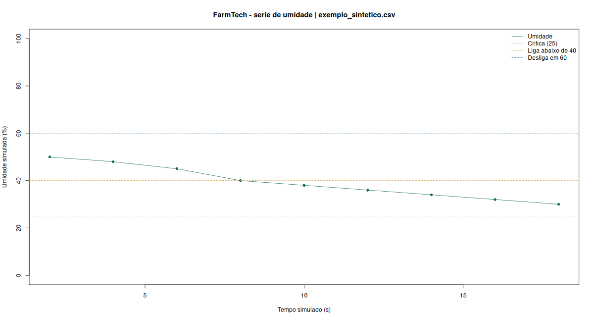

# Validação da versão preparada

Esta página distingue testes executados, exemplos sintéticos e etapas ainda pendentes. Os arquivos em `docs/evidencias/` preservam os resultados; as imagens em `docs/imagens/` foram capturadas no Wokwi.

## ESP32 no Wokwi

O `sketch.ino` foi compilado na plataforma com **DHT sensor library for ESPx**, usando o circuito deste pacote. A simulação iniciou e emitiu cabeçalho e linhas CSV.

| Verificação executada | Evidência observada |
|---|---|
| Partida com umidade 50 | `bomba=0`, `HISTERESE_MANTEM_DESLIGADA` |
| Umidade 35, controle local | `bomba=1`, `UMIDADE_BAIXA`; LED da carga aceso |
| Umidade 65 | `bomba=0`, `UMIDADE_SUFICIENTE`; LED da carga apagado |
| Botões N, P e K | Entradas passaram de `0,0,0` para `1,1,1`; mensagens lembraram o ajuste do LDR |
| Mudança manual do LDR | ADC/pH passaram de `1858 / 6.35` para `1760 / 6.02` |
| `CHUVA 5 80` com umidade 35 | `clima_valido=1`, `bomba=0`, `CHUVA_PREVISTA`; LED apagado |
| Umidade 20, mantendo `CHUVA 5 80` | `bomba=1`, `SOLO_CRITICAMENTE_SECO`; prioridade da condição crítica |
| Comandos `R LIGAR`, `R DESLIGAR` e `R AUTO` | Recebidos pelo Monitor Serial; ligar/desligar e retorno ao controle local registrados |

O módulo foi configurado como `transistor=pnp`; **LOW conecta a carga COM-NO e HIGH a desconecta**, conforme verificado pelo LED externo. O indicador LED1 do próprio desenho do módulo não deve ser utilizado como única evidência do estado da carga nessa configuração. As capturas mostram os contatos em funcionamento pelo LED azul externo e pelo log.

O log real está em `docs/evidencias/serial_wokwi.txt`, com as linhas extraídas em `sensores_wokwi.csv`. A simulação estava mais lenta que o relógio real. A tabela do README usa tempo simulado. O ciclo contínuo de 120 s e a expiração de 6 h não foram aguardados no navegador; foram verificados por testes de software. As quatro transições completas de histerese estão cobertas em C++.

## C++: decisões e proteção

O compilador g++ executou `tests/test_decisao.cpp` com C++17 e avisos ativados, incluindo o próprio sketch por meio de substitutos de hardware.

Resultado: **passou**, sem avisos de compilação nessa execução.

Cobertura: valores imediatamente abaixo/no limite 40 e 60; estado anterior na histerese; chuva com limites 3 mm e 60%; exceção de umidade crítica 25; prioridade de R/clima; umidade inválida/NaN; falha DHT22; bloqueio de tempo; rearme; expiração e retorno de `millis()`; rejeição de comando inválido; debounce pressionar/liberar.

Log: `docs/evidencias/testes_cpp.txt`. Estes substitutos não verificam a eletrônica: por isso há uma compilação e uma execução separadas no Wokwi.

## Python: API e tratamento de dados

Os **seis testes** em `tests/test_python.py` passaram: janela meteorológica futura, dados ausentes, probabilidade inválida, janela incompleta, horários duplicados e extração de registros CSV.

Uma consulta real à Open-Meteo foi executada para o ponto aproximado de demonstração Varginha/MG. `resumo_api.json` registra o timestamp, as horas selecionadas, os valores e o endereço consultado; `consulta_api.json` contém a resposta. O resultado é histórico, não uma previsão para usar no dia da entrega.

O comando chuvoso `CHUVA 5 80` empregado no teste Wokwi foi **um cenário controlado**, não o resultado dessa consulta. A ligação entre o Python e o simulador é manual, como documentado no README.

## R: descrição e recomendação

O script foi executado com **R 4.3.3**, sem pacotes adicionais. Com `dados/exemplo_sintetico.csv`, obteve:

- Média de todas as 9 leituras: **39,22%**.
- Média das últimas 5: **34,00%**.
- Inclinação: **−1,000 ponto percentual por segundo simulado**.
- Estimativa da próxima leitura: **28,00%**.
- Comando: **`R LIGAR`**.

Esses números pertencem a uma série construída para testar o comportamento; não são medições de uma fazenda. O gráfico é `docs/evidencias/grafico_r_sintetico.png`.

Também foram executados seis cenários de integração usando CSVs temporários: sequência seca → `R LIGAR`; úmida → `R DESLIGAR`; intermediária → `R AUTO`; menos de cinco registros → `R AUTO`; última leitura inválida → `R AUTO`; todas as umidades ausentes → `R AUTO`. Todos passaram. Logs: `testes_r.txt` e `execucao_r.txt`.

A análise também foi executada sobre os **11 registros reais do simulador** extraídos do Monitor Serial, que são medições simuladas, não dados de campo. As últimas cinco leituras deram média de **29,00%**, tendência de aproximadamente **−2,242 pontos percentuais/s** e estimativa seguinte de **15,50%**, resultando em `R LIGAR`. `resumo_r_wokwi.csv` e `grafico_r_wokwi.png` preservam as saídas. As mudanças de umidade foram feitas pelo operador; a tendência não representa uma taxa natural de secagem medida em uma fazenda.

## Pendências da entrega acadêmica

- Executar o circuito na sua conta, salvar e inserir o endereço Wokwi.
- Revisar o texto, conferir nome e RM e preencher curso/turma.
- Subir as fontes e imagens no seu GitHub.
- Gravar a demonstração, publicar no YouTube como não listado e inserir o link real.

Nenhum endereço de repositório, projeto salvo ou vídeo foi fabricado. As etapas externas continuam identificadas como pendentes no README.
